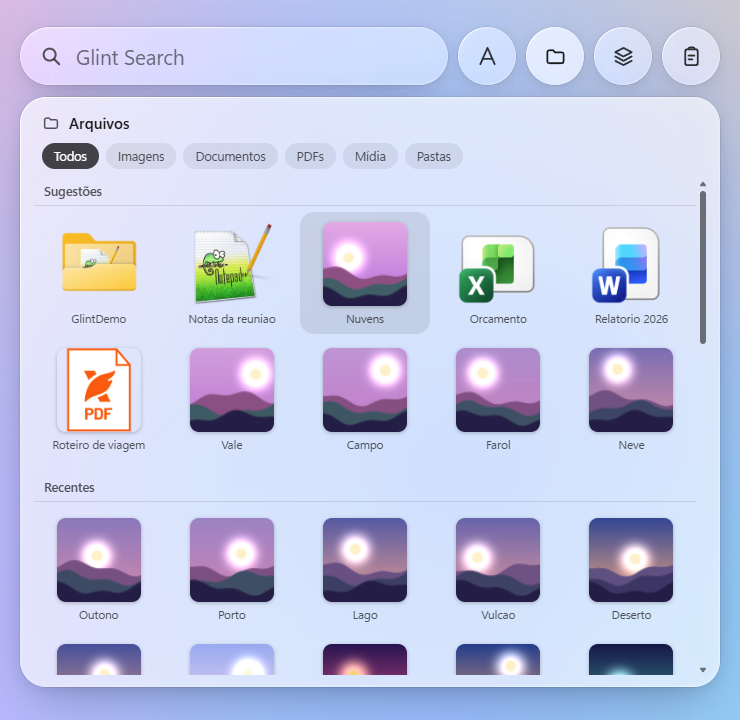
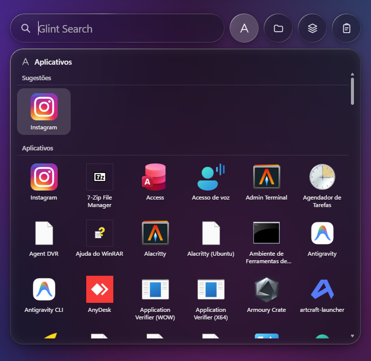
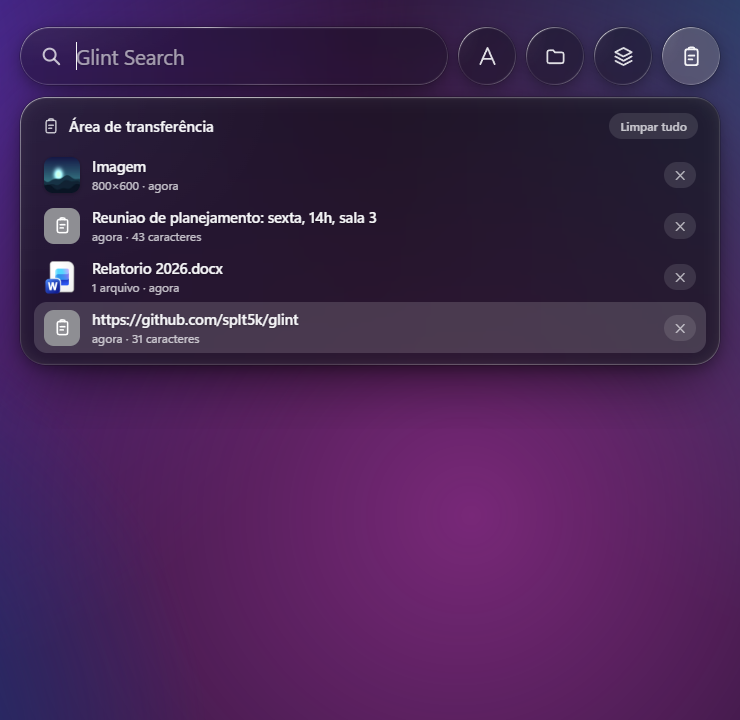
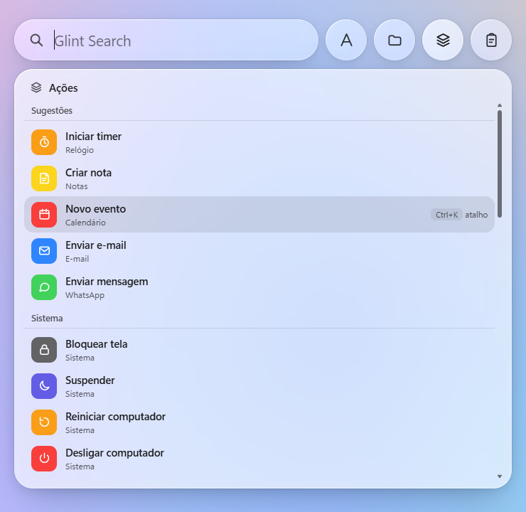
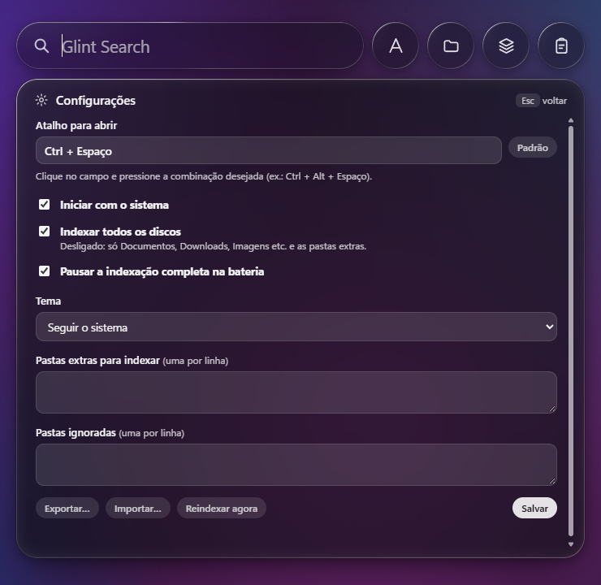

# Glint

Busca rápida para **Windows e Linux** com visual de vidro translúcido: cápsula de busca, atalho global, aplicativos, arquivos, ações, histórico da área de transferência, cálculos e conversões.

*English:* a fast launcher for Windows and Linux with a translucent glass look (Tauri 2: Rust + web UI). MIT licensed. Installers for Windows and Linux are on the [Releases](../../releases) page.

<p align="center">
  
  
</p>
<p align="center">
  
  
</p>
<p align="center">
  
</p>

## Instalação

Baixe o instalador na página de [Releases](../../releases):

| Sistema | Arquivo |
|---|---|
| Windows 10/11 | `Glint_x.y.z_x64-setup.exe` (instala só para o seu usuário, sem administrador) |
| Debian, Ubuntu, Zorin, Mint | `.deb` |
| Fedora, openSUSE | `.rpm` |
| Qualquer distro | `.AppImage` (`chmod +x` e executar) |
| Arch, CachyOS, Manjaro | `packaging/arch/PKGBUILD` (`makepkg -si`) |

**Linux, jeito rápido (AppImage):** baixe o `.AppImage` e o script [`packaging/linux/install-glint.sh`](packaging/linux/install-glint.sh) para a mesma pasta e rode `bash install-glint.sh`. Ele instala em `~/Aplicativos`, cria o atalho no menu e o início automático, e abre o Glint.

Depois de instalado ele inicia com o sistema (dá para desligar nas Configurações).

> **Status no Linux:** o código é portável, mas a maior parte dos testes foi feita no Windows. Veja "Limitações".

## Uso
- **Ctrl+Espaço** abre e fecha (o atalho é configurável).
- **Ctrl+1..4**: Aplicativos, Arquivos, Ações, Área de transferência.
- **Ctrl+,**: Configurações. **Ctrl+K**: palavra-atalho para o item selecionado. **Espaço / Ctrl+Y**: prévia rápida.
- **Enter** abre ou executa; **Ctrl+Enter** mostra o arquivo na pasta.
- **Comandos na busca** (rodam só no Enter, e o item mostra o comando exato): `ssh usuario@host[:porta]` (também completa os apelidos do seu `~/.ssh/config`), `ping host`, `rdp host` (Windows), `\\servidor\pasta` (pasta de rede), `192.168.0.1:8080` (abre no navegador) e `brave globo` / `chrome globo.com` / `firefox receita` (navegador com pesquisa ou site).
- **Sites conhecidos** (Gmail, YouTube, Hotmail/Outlook, WhatsApp Web, GitHub, ChatGPT...) aparecem pelo nome, com o ícone do site; Enter abre no navegador. O ícone vem do serviço de favicons do Google e dá para desligar em Configurações.
- **Avisa quando há versão nova** (consulta o GitHub 1x por dia; desligável).
- Busca de arquivos com várias palavras e extensão: `maio .docx` acha `ponto_maio.docx`.
- Botão direito (ou Shift+F10) abre o menu do item: fixar nas sugestões, abrir local do arquivo, desinstalar, copiar caminho...
- Exemplos: `timer 10 min`, `nota: comprar leite`, `reunião amanhã 14h`, `15% de 200`, `10 km em mi`, `100 usd em brl`.

### Área de transferência
Guarda texto, **imagens** (prints, imagens copiadas), **arquivos e vídeos** copiados (pelo caminho, com miniatura). Enter coloca o item de volta no formato original (arquivos voltam como arquivos, colam no Explorer). O histórico fica **só na memória**, com limite de itens e de tamanho; nada vai para o disco.

## Configurações
Em `Ctrl+,` ou no ícone da bandeja: atalho (com aviso se já estiver em uso por outro programa), iniciar com o sistema, tema, pastas extras e ignoradas, indexar todos os discos ou só as pastas pessoais, pausar a indexação na bateria. **Exportar** e **Importar** salvam/leem um `.json`; ao importar, você revisa e clica em Salvar. O arquivo de configuração fica em `%LOCALAPPDATA%\Glint\config.json` (Windows) ou `~/.local/share/Glint/config.json` (Linux).

## Desempenho
- **Indexa todos os discos por padrão**, para a busca ser um ponto único: no Windows, todos os discos fixos; no Linux, todos os discos reais montados (ext4, btrfs, xfs, NTFS, exFAT...), sem as pastas do sistema. Para excluir algo, use **Pastas ignoradas** nas Configurações.
- Índice de nomes de arquivos em memória (cerca de 290 mil itens em ~0,3 s no teste do autor, com limite de itens).
- A indexação roda em poucas threads de baixa prioridade (CPU e disco) e, na bateria, só indexa as pastas pessoais.
- A busca roda em segundo plano; cada tecla cancela a anterior.

## Limitações
- O desfoque do vidro usa uma foto do fundo tirada ao abrir; ele não acompanha o que muda atrás da janela enquanto está aberto.
- **Linux/Wayland:** o sistema não permite atalhos globais a aplicativos. Crie um atalho do sistema que execute `glint` (ele abre a janela). No X11 o atalho global funciona. O `Ctrl+Espaço` costuma estar ocupado pelo seletor de idioma (IBus/Fcitx): troque o atalho nas Configurações.
- **Linux:** por enquanto não há captura do fundo (o painel usa um véu sólido em vez do desfoque real) e os ícones nativos dos aplicativos e as miniaturas ainda não foram validados.
- Conversões de moeda precisam de internet.

## Compilar
Requisitos: Rust (estável), Node.js 20+; no Linux, as dependências do Tauri 2 (`libwebkit2gtk-4.1-dev`, `libayatana-appindicator3-dev`, `libxdo-dev`, `libgtk-3-dev`).

```bash
npm ci
npx tauri build          # gera os instaladores em src-tauri/target/release/bundle
npx tauri build --no-bundle   # só o executável
```

Variáveis para testes visuais: `GLINT_THEME=light|dark`, `GLINT_KEEP=1` (não esconde ao perder o foco), `GLINT_DUMP_BD=arquivo.jpg` (salva o fundo capturado), `GLINT_LOG=1` (mostra mensagens de depuração no terminal).

## Licença
[MIT](LICENSE)
